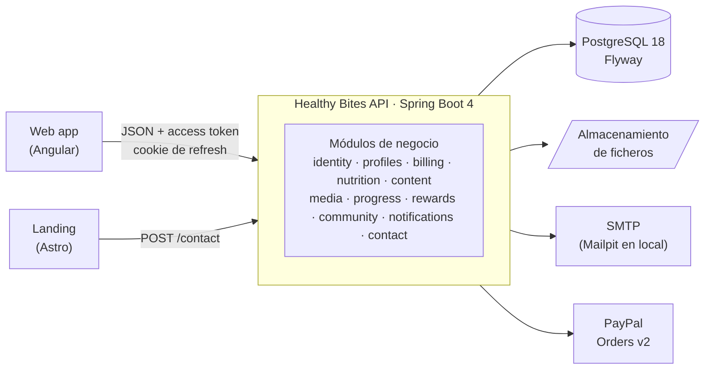

<div align="center">

<h1>Healthy Bites · API REST</h1>

<p><strong>Backend de la plataforma de nutrición, hábitos y comunidad Healthy Bites.</strong></p>


[Funcionalidad](#funcionalidad) · [Arquitectura](#arquitectura) · [Ejecución local](#ejecución-local) ·
[Pruebas](#pruebas-y-calidad) · [Configuración](#configuración) · [Seguridad](#seguridad) · [Equipo](#equipo)

</div>

## Sobre el proyecto

Mantener hábitos saludables de forma constante es difícil sin herramientas que se adapten a cada persona.
**Healthy Bites** reúne en una sola plataforma planes alimenticios creados por nutricionistas, contenido educativo,
seguimiento de metas y hábitos, rachas con recompensas y una comunidad para compartir avances.

Este repositorio contiene la **API REST** que da servicio a toda la plataforma. Nació como proyecto académico y se
ha reescrito como un monolito modular con las versiones y prácticas actuales. Forma parte de tres repositorios:

| Repositorio                                                                       | Descripción                                         |
| --------------------------------------------------------------------------------- | --------------------------------------------------- |
| [healthy-bites-api](https://github.com/vfernandezg-dev/healthy-bites-api)         | API REST en Spring Boot + PostgreSQL (este repo)    |
| [healthy-web-app](https://github.com/vfernandezg-dev/healthy-web-app)             | Aplicación web en Angular                           |
| [healthy-bites-landing](https://github.com/vfernandezg-dev/healthy-bites-landing) | Landing page en Astro (usa el endpoint de contacto) |

## Funcionalidad

Tres roles: **cliente**, **nutricionista** y **ADMIN**. Todas las rutas cuelgan de `/api/v1`.

| Rol           | Qué puede hacer                                                                                                                                                                                                                         |
| ------------- | --------------------------------------------------------------------------------------------------------------------------------------------------------------------------------------------------------------------------------------- |
| Cliente       | Registrarse, completar su perfil, marcar metas de peso con sus pesajes y una recomendación de peso saludable, registrar hábitos a diario, seguir planes alimenticios, abrir contenido, completar rachas para ganar premios, suscribirse con PayPal y participar en la comunidad |
| Nutricionista | Darse de alta por invitación, crear y publicar planes alimenticios con sus comidas, publicar artículos, vídeos y guías (con portada y fichero), crear recompensas y ver a sus clientes                                                     |
| ADMIN         | Gestionar usuarios (activar y desactivar), invitar nutricionistas, moderar las denuncias de la comunidad y consultar la facturación                                                                                                      |

Los contenidos y planes tienen un nivel (`BASIC`, `PREMIUM` o `VIP`). Un cliente abre lo que su suscripción pagada
incluye, más lo que desbloquea con recompensas. Los correos importantes (bienvenida, justificante de pago, fin de la
suscripción, premio conseguido, solicitudes para entrar en un grupo privado) salen solos a partir de eventos.

El contrato completo está en [`docs/openapi.yaml`](docs/openapi.yaml). Con la API en local, Swagger UI está en
`http://localhost:8090/api/v1/swagger-ui/index.html` (solo en el perfil de desarrollo).

| Módulo        | Rutas principales                                                                                                  |
| ------------- | ------------------------------------------------------------------------------------------------------------------ |
| identity      | `/auth/login`, `/auth/refresh`, `/auth/logout`, `/auth/forgot-password`, `/auth/reset-password`, `/me/password`, `/admin/users`, `/admin/nutritionist-invitations` |
| profiles      | `/auth/register`, `/auth/invitations/{preview,accept}`, `/me`, `/me/profile`                                       |
| billing       | `/subscription-plans`, `/me/subscription` (+ `checkout`, `checkout/capture`, `cancel`), `/me/payments`, `/admin/subscriptions`, `/admin/payments`, `/admin/billing/summary` |
| nutrition     | `/meal-plans`, `/me/meal-plan-enrollments`, `/nutritionist/meal-plans` (+ `meals`, `publish`, `archive`), `/nutritionist/clients` |
| content       | `/content-items`, `/content-items/{id}/file`, `/me/content-unlocks`, `/nutritionist/content-items`                 |
| media         | `/media` (subida), `/media/{id}` (ficheros públicos o con URL firmada)                                             |
| progress      | `/me/goals` (+ `complete`, `abandon`, `status-history`, `recommendation`, `weight-entries`), `/me/habit-logs`      |
| rewards       | `/rewards`, `/me/streaks`, `/nutritionist/rewards`                                                                 |
| community     | `/groups` (+ `members`, `posts`), `/posts/{id}` (+ `comments`, `reports`), `/comments/{id}`, `/admin/moderation/reports` |
| notifications | Sin rutas: escucha eventos y envía correos                                                                         |
| contact       | `/contact` (formulario de la landing)                                                                              |

## Arquitectura



La API es un **monolito modular** verificado con [Spring Modulith](https://spring.io/projects/spring-modulith): un
solo despliegue, pero cada funcionalidad vive en su módulo con fronteras que se comprueban en cada build
([ADR 0001](docs/adr/0001-monolito-modular.md)).

- **El mapa de módulos**, con sus dependencias y eventos, se genera desde el código en
  [`docs/modules.md`](docs/modules.md). CI falla si no está al día.
- **Cada módulo** (`com.healthybites.<módulo>`) expone su API en el paquete raíz (interfaces y `record`) y sus
  eventos en `events`. Lo demás es interno: `domain` (entidades y repositorios), `app` (servicios y listeners),
  `web` (controladores y DTO) e `infra` (clientes externos).
- **Entre módulos** solo se comparten identificadores (UUID): ninguna entidad referencia a la de otro módulo. Las
  claves foráneas sí existen en la base de datos.
- **Los eventos** (`UserRegistered`, `SubscriptionActivated`, `HabitLogged`, `RewardEarned`...) solo llevan ids. Se
  guardan en `event_publication` en la misma transacción que el cambio y se entregan tras el commit; si un listener
  falla, se reintenta ([ADR 0005](docs/adr/0005-eventos-persistidos.md)).
- **`shared`** es el núcleo común: entidad base (UUIDv7, versión y auditoría), errores RFC 9457, seguridad,
  paginación, correo, limitación de peticiones y reintentos de eventos.

| Decisión                                                    | ADR                                                  |
| ----------------------------------------------------------- | ---------------------------------------------------- |
| Monolito modular con Spring Modulith                        | [0001](docs/adr/0001-monolito-modular.md)            |
| Sesión: access token en memoria + refresh token rotatorio   | [0002](docs/adr/0002-sesion-con-tokens.md)           |
| Identificadores UUIDv7                                      | [0003](docs/adr/0003-identificadores-uuidv7.md)      |
| Esquema con Flyway y Hibernate en modo `validate`           | [0004](docs/adr/0004-esquema-con-flyway.md)          |
| Eventos persistidos entre módulos                           | [0005](docs/adr/0005-eventos-persistidos.md)         |
| Errores RFC 9457 con código estable                         | [0006](docs/adr/0006-errores-rfc-9457.md)            |
| Contrato OpenAPI versionado y tipos generados en el web-app | [0007](docs/adr/0007-contrato-openapi.md)            |
| Ficheros en un almacenamiento de objetos S3-compatible      | [0008](docs/adr/0008-almacenamiento-de-objetos.md)   |
| REST estandarizado en lugar de GraphQL                      | [0009](docs/adr/0009-rest-frente-a-graphql.md)       |
| Preparada para varias instancias                            | [0010](docs/adr/0010-varias-instancias.md)           |

### Convenciones de la API

La guía completa, con la deuda conocida, está en [`docs/api-guidelines.md`](docs/api-guidelines.md).

- Recursos en plural y en kebab-case, agrupados por audiencia: público (`/auth`, `/contact`), usuario actual
  (`/me/**`), catálogos, espacio del nutricionista (`/nutritionist/**`) y administración (`/admin/**`).
- Crear responde `201` con una `Location` absoluta; modificar es un `PUT` completo; las transiciones son
  `POST /<acción>` (`publish`, `complete`, `cancel`...); borrar responde `204`.
- Toda colección que crece se pagina con `?page&size&sort` (20 por defecto, 100 como máximo) y solo por campos
  permitidos; los paneles usan resúmenes (`…/summary`) en lugar de descargar listas.
- Errores en formato [RFC 9457](https://www.rfc-editor.org/rfc/rfc9457) con un `code` estable y, si hay campos
  inválidos, `errors[{field, message}]` en español.
- Fechas en ISO-8601, ids UUID e importes como texto (`"5.99"`). Ningún cuerpo lleva el id del propietario: sale del
  token.

## Stack

| Área          | Tecnología                                                                                                    |
| ------------- | ------------------------------------------------------------------------------------------------------------- |
| Lenguaje      | Java 25 (hilos virtuales)                                                                                     |
| Framework     | Spring Boot 4.1: Web MVC, Data JPA (Hibernate 7), Security 7, Validation, Mail, Thymeleaf, Actuator           |
| Arquitectura  | Spring Modulith 2.1 (módulos verificados, eventos persistidos en JDBC), ArchUnit                              |
| Base de datos | PostgreSQL 18 con migraciones Flyway; Docker Compose en desarrollo                                            |
| Seguridad     | Resource server de Spring Security (JWT HS512) + refresh token opaco en cookie, BCrypt                        |
| Integraciones | PayPal Orders v2, SMTP con plantillas Thymeleaf (Mailpit en local)                                            |
| Utilidades    | MapStruct, Lombok, JSpecify, springdoc-openapi                                                                |
| Pruebas       | JUnit 6, AssertJ, Mockito, MockMvc, Testcontainers, JaCoCo                                                    |
| Build         | Maven Wrapper, Spotless (palantir-java-format), imagen Docker multi-stage                                     |

## Ejecución local

### Requisitos

- **JDK 25** (por ejemplo, Temurin 25).
- **Docker**, para PostgreSQL y Mailpit.

### Pasos

```bash
# 1. Variables de entorno: copia la plantilla y rellena JWT_SECRET
#    (openssl rand -base64 64 | tr -d '\r\n') y, si vas a probar pagos, PayPal sandbox.
cp .env.example .env

# 2. Arrancar la API en http://localhost:8090/api/v1
./mvnw spring-boot:run
```

`spring-boot:run` usa el perfil `dev`, que:

- carga `.env`;
- levanta PostgreSQL (puerto 5433) y [Mailpit](https://mailpit.axllent.org) con
  [`docker-compose.yml`](docker-compose.yml) y conecta la base de datos sola;
- aplica las migraciones de Flyway y carga los datos de demostración
  ([`db/seed-dev`](src/main/resources/db/seed-dev/R__dev_seed.sql));
- envía todos los correos a Mailpit, que los muestra en `http://localhost:8025` (nada sale a Internet);
- solo escucha en `127.0.0.1` y publica Swagger UI.

Todas las cuentas de demostración usan la contraseña `healthy123`:

| Rol           | Cuenta                                                           |
| ------------- | ---------------------------------------------------------------- |
| ADMIN         | `admin@healthybites.com`                                         |
| Nutricionista | `carlos.garcia@healthybites.com`, `elena.gomez@healthybites.com` |
| Cliente       | `juan.perez@healthybites.com` (plan Básico)                      |
| Cliente       | `maria.lopez@healthybites.com` (Premium)                         |
| Cliente       | `pedro.gomez@healthybites.com` (VIP)                             |

Los datos de demostración solo se cargan en los perfiles `dev` y `test`.

## Pruebas y calidad

```bash
./mvnw verify           # tests, cobertura y formato
./mvnw spotless:apply   # formatea el código
```

Solo hace falta Docker en marcha. Los tests de integración levantan la aplicación completa sobre un PostgreSQL
efímero ([Testcontainers](https://testcontainers.com)) con las migraciones y el seed de demostración. Los correos y
PayPal se simulan.

- **Un test por módulo** (`AuthenticationTests`, `SubscriptionTests`, `MealPlanTests`, `ContentTests`,
  `ProgressTests`, `RewardTests`, `CommunityTests`, `NotificationTests`...) recorre sus casos de uso por HTTP,
  incluidos los accesos de otros usuarios (`404`), de otros roles (`403`) y sin sesión (`401`).
- **`ModularityTests`** verifica las fronteras entre módulos y genera [`docs/modules.md`](docs/modules.md).
- **`ArchitectureTests`** (ArchUnit) vigila las reglas de diseño: entidades sin `@Data` ni setters públicos, la
  capa web no usa repositorios, DTO como `record`, sin `LocalDateTime` ni `Date` en la API y sin inyección por
  campo.
- **`OpenApiExportTests`** exporta [`docs/openapi.yaml`](docs/openapi.yaml), del que el web-app genera sus tipos.
- Pruebas unitarias del dominio (rachas, cliente de PayPal, rotación de refresh tokens, límites de peticiones...).

CI ([`.github/workflows/ci.yml`](.github/workflows/ci.yml)) ejecuta `./mvnw verify` en cada push y pull request,
comprueba que el contrato OpenAPI y el mapa de módulos están al día y pasa
[gitleaks](https://github.com/gitleaks/gitleaks) para detectar secretos. Dependabot mantiene al día Maven, Docker y
las acciones de GitHub.

## Configuración

Ningún secreto se versiona. Toda la configuración llega de variables de entorno: en local, del fichero `.env`
(plantilla documentada en [`.env.example`](.env.example)); en producción, del proveedor de hosting. La aplicación
**no arranca** si falta un secreto obligatorio o si `JWT_SECRET` es demasiado corto.

| Variable                                   | Obligatoria                        | Uso                                                                               |
| ------------------------------------------ | ---------------------------------- | --------------------------------------------------------------------------------- |
| `JWT_SECRET`                               | Sí                                 | Clave HS512 de los JWT (Base64, ≥ 64 bytes)                                       |
| `DB_URL`, `DB_USERNAME`, `DB_PASSWORD`     | Sí (en local, solo `DB_PASSWORD`)  | Conexión a PostgreSQL                                                             |
| `MAIL_USERNAME`, `MAIL_PASSWORD`           | En producción                      | Cuenta SMTP que envía los correos                                                 |
| `APP_FRONTEND_URL`, `API_PUBLIC_URL`       | En producción                      | URLs públicas del web-app (enlaces de los correos, vuelta de PayPal) y de la API  |
| `PAYPAL_CLIENT_ID`, `PAYPAL_CLIENT_SECRET` | Para pagos                         | Credenciales de PayPal (sandbox)                                                  |
| `CORS_APP_ORIGINS`, `CORS_LANDING_ORIGINS` | En producción                      | Orígenes del web-app (toda la API, con credenciales) y de la landing (`/contact`) |
| `CONTACT_RECIPIENT`                        | No                                 | Buzón del formulario de contacto (por defecto, `MAIL_USERNAME`)                   |
| `APP_TIME_ZONE`                            | No                                 | Zona horaria de las fechas de los correos (por defecto, `America/Lima`)           |
| `STORAGE_TYPE`                             | Con varias instancias              | `local` (carpeta, por defecto) o `s3` (Cloudflare R2, AWS S3) para los ficheros   |
| `STORAGE_LOCATION`                         | No                                 | Carpeta de los ficheros con `STORAGE_TYPE=local` (por defecto, `uploads`)         |
| `S3_ENDPOINT`, `S3_BUCKET`, `S3_ACCESS_KEY`, `S3_SECRET_KEY` | Con `STORAGE_TYPE=s3` | Almacenamiento de objetos (`S3_REGION` y `S3_PATH_STYLE`: `auto` y `true`) |
| `DB_POOL_SIZE`                             | No                                 | Conexiones del pool por instancia (por defecto, 10)                               |
| `RATE_LIMIT_STORE`                         | No                                 | Límites de peticiones en `jdbc` (compartidos, por defecto) o `memory`             |
| `SERVER_TOMCAT_REMOTEIP_INTERNAL_PROXIES`  | Según el hosting                   | IPs del proxy en las que confiar para `X-Forwarded-For`                           |
| `PORT`                                     | No                                 | Puerto HTTP (por defecto, `8090`)                                                 |
| `JWT_ACCESS_TOKEN_TTL`, `SHOW_SQL`         | No                                 | Validez del access token (ISO-8601, `PT15M`) y log del SQL                        |

En producción (perfil `prod`) los logs salen en formato estructurado ECS y cada respuesta lleva `X-Request-Id`
para seguir una petición en los logs.

## Seguridad

- **Sesión** ([ADR 0002](docs/adr/0002-sesion-con-tokens.md)). `POST /auth/login` devuelve un **access token JWT**
  de 15 minutos (el web-app lo guarda solo en memoria) y deja un **refresh token** en una cookie
  `HttpOnly; Secure; SameSite=Strict` limitada a `/api/v1/auth`. `POST /auth/refresh` lo rota en cada uso: si llega
  uno ya usado, se revoca toda la sesión (detección de robo), salvo en los 20 s siguientes a la rotación (dos
  pestañas a la vez). Las sesiones caducan a los 7 días sin uso y, como máximo, a los 30. Refresh y logout exigen
  `X-Requested-With` y un `Origin` permitido.
- **Autorización.** Los roles se comprueban por prefijo (`/admin/**`, `/nutritionist/**`) y por endpoint. La
  identidad sale siempre del token: cada servicio filtra por el usuario actual, así que un recurso ajeno responde
  `404`, como si no existiera.
- **Acceso de pago en el servidor.** Un contenido o plan de pago solo se abre con una suscripción **pagada** del
  nivel necesario o con un desbloqueo por recompensa; los ficheros protegidos se sirven con una URL firmada (HMAC)
  de vida corta.
- **Restablecer la contraseña.** `POST /auth/forgot-password` responde siempre `202`, exista o no la cuenta. El
  enlace lleva el token en el fragmento (`#token=…`), que no llega a los logs ni al `Referer`. Del token solo se
  guarda el hash: caduca a los 30 minutos, sirve una vez y cambiar la contraseña cierra todas las sesiones. Las
  invitaciones de nutricionistas siguen el mismo esquema.
- **Pagos con PayPal.** Las URLs de vuelta las construye el servidor. La captura solo acepta pedidos del propio
  usuario, comprueba importe y moneda y es idempotente; cada petición a PayPal lleva `PayPal-Request-Id`.
- **Ficheros subidos.** El tipo se detecta por los bytes: JPG, PNG, WebP y GIF hasta 5 MB, PDF hasta 20 MB y MP4
  hasta 100 MB. Los clientes solo suben imágenes para sus publicaciones; portadas y ficheros de contenido son cosa de
  nutricionistas y ADMIN. SVG y HTML se rechazan, el nombre en disco lo genera el servidor y se sirven con `nosniff`,
  CSP `sandbox` y `attachment` si no son imagen ni vídeo.
- **Límites de peticiones** en login (por cuenta e IP), refresh, restablecimiento, registro y contacto, con
  `429` y `Retry-After`.
- CORS por listas blancas, cabeceras de seguridad (CSP, HSTS, `nosniff`, `Referrer-Policy`, `X-Frame-Options`),
  Swagger solo en desarrollo y Actuator limitado a `/actuator/health`.

## Formulario de contacto

`POST /api/v1/contact` es público y lo usa la [landing page](https://github.com/vfernandezg-dev/healthy-bites-landing).
Su contrato no ha cambiado con la reescritura.

```json
{ "nombre": "Ana", "apellido": "Torres", "correo": "ana@correo.com", "mensaje": "Hola…", "website": "" }
```

| Respuesta | Cuándo                                                                |
| --------- | --------------------------------------------------------------------- |
| `204`     | Mensaje enviado a `CONTACT_RECIPIENT`, con _reply-to_ al visitante    |
| `422`     | Datos inválidos (mismas reglas que valida la landing)                 |
| `429`     | Límite superado: 5 mensajes cada 10 min por IP y 50 por hora en total |
| `503`     | El servidor de correo no está disponible                              |

El campo `website` es un _honeypot_: si llega con valor, el mensaje se descarta y se responde `204`. Nunca se envía
un correo automático al visitante, así que el endpoint no sirve para mandar spam a terceros.

## Gestión del proyecto

El avance se organizó en un [tablero de Trello](https://trello.com/b/X7usPWHI/healty-bites) con las columnas
Backlog, En progreso, Revisión, En pruebas y Hecho.

## Equipo

Healthy Bites es un proyecto académico. **Valentin Fernandez** lideró el proyecto y desarrolló y configuró la
plataforma completa: esta API REST, la aplicación web (Angular), la landing (Astro), el despliegue y la integración
continua.

| Integrante         | Rol                        | Perfil                                                                    |
| ------------------ | -------------------------- | ------------------------------------------------------------------------- |
| Valentin Fernandez | Líder técnico · Full Stack | [LinkedIn](https://www.linkedin.com/in/vfernandezg-dev/)                  |
| Camila Moreno      | Diseño UI/UX               | [LinkedIn](https://www.linkedin.com/in/camila-moreno-quevedo-01871a324/)  |
| Alessia Aguilar    | Base de datos              | [LinkedIn](https://www.linkedin.com/in/alessia-aguilar-857670286/)        |
| Jhonnatan Chavez   | Arquitectura de software   | [LinkedIn](https://www.linkedin.com/in/jhonnatan-del-castillo-a73a24316/) |
| Renzo Lavado       | Comercial                  | [LinkedIn](https://www.linkedin.com/in/renzo-lavado-41aba2296/)           |
