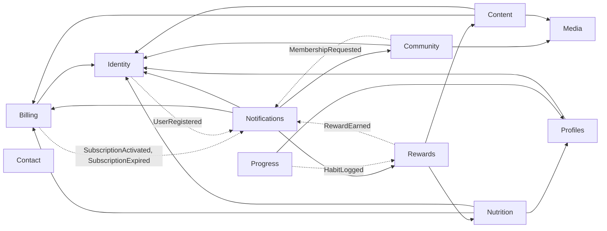

<!-- Generado por ModularityTests a partir del código: no lo edites a mano. -->

# Módulos

Monolito modular verificado con Spring Modulith: cada módulo solo usa la API pública de los demás (su paquete raíz y sus paquetes `events`) y no hay ciclos. Todos usan `shared`, que se omite en el diagrama.

- Flecha continua: el módulo de origen usa la API del de destino.
- Flecha discontinua: el evento viaja del módulo que lo publica a los que lo escuchan (persistido en `event_publication` y entregado tras el commit).

| Módulo | Paquete | Usa | Publica | Escucha |
|---|---|---|---|---|
| Billing | `com.healthybites.billing` | identity, shared | SubscriptionActivated, SubscriptionExpired | — |
| Community | `com.healthybites.community` | identity, media, shared | MembershipRequested | — |
| Contact | `com.healthybites.contact` | shared | — | — |
| Content | `com.healthybites.content` | billing, identity, media, shared | — | — |
| Identity | `com.healthybites.identity` | shared | UserDeactivated, UserRegistered | — |
| Media | `com.healthybites.media` | shared | — | — |
| Notifications | `com.healthybites.notifications` | billing, community, identity, rewards, shared | — | MembershipRequested, RewardEarned, SubscriptionActivated, SubscriptionExpired, UserRegistered |
| Nutrition | `com.healthybites.nutrition` | billing, identity, profiles, shared | — | — |
| Profiles | `com.healthybites.profiles` | identity, shared | — | — |
| Progress | `com.healthybites.progress` | profiles, shared | GoalCompleted, HabitLogged | — |
| Rewards | `com.healthybites.rewards` | content, nutrition, shared | RewardEarned | HabitLogged |
| Shared | `com.healthybites.shared` | — | — | — |
